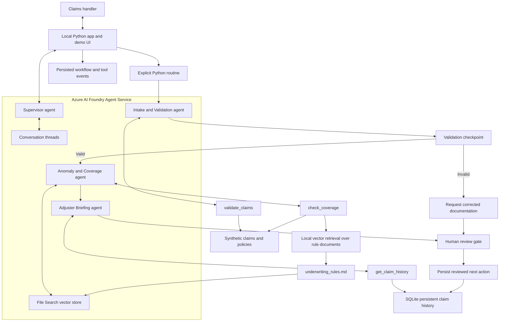

# Implementation architecture

The arrows express logical dependencies, not direct autonomous handoffs. Python invokes each agent in the defined order and passes structured results. The supervisor routes intent, while the application enforces the state transitions. All remote agents use one configured model deployment but have different instructions and tools.

## Data boundaries

The local client owns input parsing, deterministic checks, tool dispatch, persistent records and review gates. Foundry owns agent definitions, model reasoning, conversation threads and managed file search. Claims and tool results sent in Azure mode are synthetic.

Local mock mode replaces remote agent reasoning with explicit deterministic routing and template prose. It retains the same tool dispatcher, data sources, retrieval, storage and gate implementation.

## Memory boundaries

- `sessions` and `messages`: per-session conversation state; Azure thread IDs are stored in session context.
- `history`: earlier valid synthetic claims, with pending/reviewed status; keyed by claim ID to avoid replay duplication.
- `batches`: complete per-run results keyed by batch ID, with independent row keys so duplicate claim IDs are never overwritten.
- `reviews`: immutable review events; the latest result status is updated transactionally.
- `events`: routing, tool execution, retrieval and error traces.

## Knowledge and decision boundaries

Rules are source documents with typed metadata. The sparse vector store supplies retrieval evidence. The rule evaluator checks factual conditions and the routine derives the allowed recommendation. In Azure mode the LLM writes supporting analysis; it cannot alter the deterministic recommendation or record a human review through a function call.

The initial slide showed JSON as an illustrative persistent store. The implementation uses SQLite to make reviews and state updates transactional. Both satisfy the assignment's simple persistent-memory requirement.
